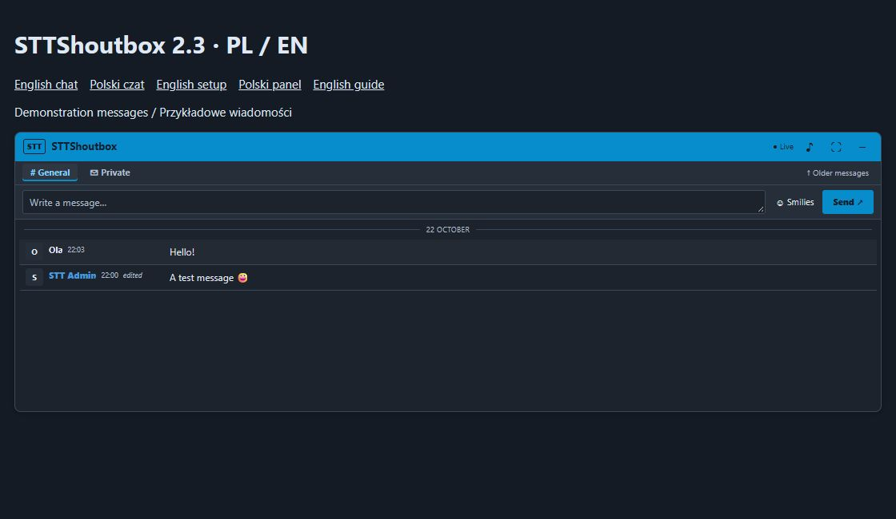

# STTShoutbox

An independent shoutbox for **MyBB 1.8**, built by **SWIRTV TEAM**. Public chat, private conversations, forum activity notifications and a beginner-friendly setup page — in **English and Polish**.

[Polski / Polish](README.pl.md) · [Download 2.5.0](https://github.com/Swir/STTShoutbox/releases/tag/v2.5.0) · [Installation guide](INSTALL.txt) · [Activity bot guide](docs/ACTIVITY-BOT.md)

## Install in three steps

Back up your forum files and database first.

1. Download the `STTShoutbox-2.5.0.zip` release asset and extract it. Upload the **contents** of `Upload` into the MyBB root directory, alongside `index.php`. Merge the `inc` and `jscripts` directories, including the new `jscripts/sttshoutbox` sound folder; do not delete their existing contents.
2. Open **Admin CP → Configuration → Plugins → STTShoutbox → Install & Activate**.
3. Click **Appearance & setup** beside the plugin. Choose the appearance, accent colour, height and message order, then save.

The chat appears on the forum homepage. No other shoutbox, PluginLibrary or separate bot account is required. The ZIP includes an offline `START-EN.html` guide and a Polish `START.html` guide.

## Features

- Public chat with group permissions, flood control and configurable message order.
- Username colours and smilies from your forum, plus a Unicode emoji picker.
- Mentions, replies, reactions, own-message editing and withdrawal.
- Private conversations, separate from MyBB PMs, respecting participant privacy settings.
- An unread-message dot and count on the private tab and collapsed header, with unread conversations listed first. Messages are marked read when the conversation is actually visible.
- Built-in bot for new threads, replies and optional member registrations. Activity cards are filtered according to each reader's forum permissions; password-protected forums are excluded.
- Independent thank-you and short-post filters, configurable phrases and word threshold, optional exemptions, and an ACP tester that evaluates examples without publishing them.
- A bundled original notification sound, with a volume control and preview. Each visitor chooses whether to enable it.
- Custom bot responses, expandable and collapsible chat.
- Automatic light/dark detection, explicit light/dark palettes, accent picker, adjustable height and spacing.
- Quick setup, missing-file diagnostics and automatic placement for standard MyBB index templates.

## Languages

The chat and API messages follow the language already resolved by MyBB for the current visitor. The setup page and native settings labels follow the **ACP language**. Polish and English are included; other languages fall back to English. Dates use the corresponding locale and the member's forum time-zone offset.

Language files:

- `Upload/inc/languages/english/sttshoutbox.lang.php`
- `Upload/inc/languages/polish/sttshoutbox.lang.php`

The plugin does not install or replace MyBB's full language packs. Install the standard Polish MyBB pack if you want Polish as a selectable forum language. Messages, forum names, custom chat names, smiley names and administrator-authored bot replies are user content and are not machine-translated.

## Configure the activity bot

Open **Admin CP → Configuration → Plugins → STTShoutbox → Activity bot**, or use the link in Quick setup. Switch notification types on/off, exclude forums, and configure the two independent filters:

- **Thank-you filter:** enabled by default, matching complete words or phrases anywhere in a reply. Edit the phrase list or choose acknowledgement-only matching.
- **Short-post filter:** enabled by default with a minimum of **10 words**. Nine words are skipped; exactly ten pass this filter.

The filters apply to replies by default; you can include new topics too. The optional link/attachment exemption is off by default and affects the short-post filter only. Filtering existing activity cards is on by default. The **tester** uses the values currently entered in the form, including unsaved changes, and explains its decision and word count without saving settings or creating a post.

These rules affect bot notifications. Forum posts, thanks/unlock plugins, chat messages and private conversations remain intact. See the [full bot guide](docs/ACTIVITY-BOT.md) for phrase matching, word counting and existing-history behaviour.

## Message sounds

The installation ZIP includes `Upload/jscripts/sttshoutbox/notify.wav`: an original short two-note chime, served from your own forum. There is no external sound service or separate download to configure. Use **♪** in the chat header to turn sound on/off; the adjacent sound settings open the volume control and preview. Sound starts disabled; the preference and volume are remembered in the current browser for each forum account.

Browsers require a click before allowing audio. After reopening the forum, interact with the page to allow your saved preference to play notifications. Loading chat history, your own messages and activity-bot notices do not make a sound. A burst of incoming messages produces at most one notification every three seconds.

## Upgrade from 2.0–2.4

Back up first. **Deactivate**, upload every file in `Upload`, then activate again and hard-refresh the forum. **Do not uninstall to update.** Include the new `jscripts/sttshoutbox/notify.wav` file. Existing conversation history, settings and chosen appearance are retained; fresh installations default to automatic appearance. Upgrades from versions before 2.4 add the filter defaults described above. Review them in **Activity bot** after updating.

## Requirements and limits

- MyBB 1.8; integration based on MyBB 1.8.41.
- PHP 8.1+ with `mbstring`; MySQL/MariaDB. SQLite and PostgreSQL are not supported.
- JavaScript in the visitor's browser; HTTPS recommended.
- Standard index templates containing `{$header}` work automatically. A custom template without that variable needs `{$sttshoutbox}` at the desired location.
- Automatic palette selection reads the surrounding background once on page load. Image or gradient backgrounds may require choosing light/dark manually.

This release is checked on PHP 8.5.12 and Chrome. The installer tests use an in-memory database double, not a full clean MyBB installation. Validate other hosting setups and heavily customised themes on a copy of your forum.

## Data and removal

Public chat messages include the sender's IP address. Account for chat storage in your forum privacy policy. Deactivation stops the chat. Uninstallation removes settings but deliberately preserves conversation tables; it is not a data-erasure operation. See [INSTALL.txt](INSTALL.txt) before removing stored data.

This package contains no forum database, user messages, credentials or third-party chat migration tool.

## Tests and contributions

With PHP CLI and `mbstring`, run `php tests/run.php tests english` and `php tests/run.php csrf polish`. Tests create a private temporary copy of the package and use in-memory database/template doubles. They do not connect to a forum database. JavaScript syntax can be checked with `node --check Upload/jscripts/sttshoutbox.js`.

Report reproducible problems in [Issues](https://github.com/Swir/STTShoutbox/issues), with MyBB/PHP versions and the affected theme. Never post passwords, API keys, database exports or private conversations.

## License

STTShoutbox code and its original notification chime: [MIT](LICENSE.txt), SWIRTV TEAM. MyBB is a separate project by the MyBB Group. No third-party theme or graphical smiley collection is bundled.
