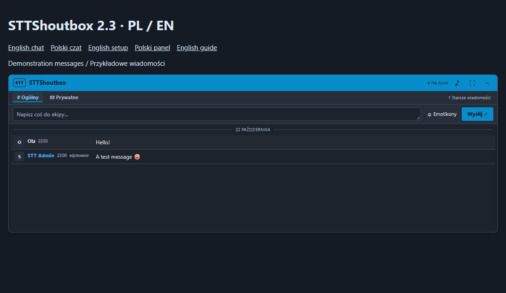

# STTShoutbox

Samodzielny shoutbox dla **MyBB 1.8**, autorstwa **SWIRTV TEAM**, dostępny po **polsku i angielsku**.

[English](README.md) · [Pobierz wydanie](https://github.com/Swir/STTShoutbox/releases) · [Pełna instrukcja](INSTALACJA.txt)

## Instalacja

Najpierw zrób kopię plików i bazy forum.

1. Pobierz `STTShoutbox-2.3.0.zip` z wydań i rozpakuj. Wgraj **zawartość folderu Upload** do katalogu MyBB, obok `index.php`. Scal katalogi `inc` i `jscripts`; nie usuwaj ich istniejącej zawartości.
2. **ACP → Konfiguracja → Pluginy → STTShoutbox → Zainstaluj i aktywuj**.
3. Kliknij **Szybki start — dopasuj czat**, wybierz wygląd i zapisz.

Czat pojawi się na stronie głównej standardowego forum. Nie wymaga innego shoutboxa, PluginLibrary ani osobnego konta bota. Paczka zawiera przewodnik `START.html` po polsku i `START-EN.html` po angielsku.

## Możliwości

- Czat ogólny, rozmowy prywatne, kolorowe nicki, emotikony i emoji.
- Wzmianki, cytowanie, reakcje, edycja i wycofywanie własnych wiadomości.
- Własny bot: nowe tematy, odpowiedzi, opcjonalnie rejestracje oraz własne odpowiedzi na komendy.
- Powiadomienia bota respektują dostęp odbiorcy do działów; działy z hasłem są pomijane.
- Wiadomości od najnowszych lub najstarszych, limity i uprawnienia grup.
- Automatyczny jasny/ciemny wygląd, kolor przewodni, wysokość i odstępy.
- Prosty panel startowy, sprawdzanie plików i pomoc w razie problemów.

## Dwa języki

Interfejs czatu i błędy używają języka ustalonego przez MyBB dla danego odwiedzającego. Panel startowy i ustawienia zaawansowane używają języka ACP. Przy innych językach używany jest angielski.

Tłumaczenia są w `Upload/inc/languages/polish/sttshoutbox.lang.php` i `english/sttshoutbox.lang.php`. Wtyczka nie instaluje całego polskiego pakietu MyBB. Własne wiadomości, nazwa czatu, działy, nazwy emotikonów i odpowiedzi bota nie są tłumaczone automatycznie.

## Aktualizacja

Zrób kopię, **dezaktywuj** wtyczkę, wgraj wszystkie pliki z Upload, aktywuj ponownie i odśwież forum. Nie odinstalowuj przy aktualizacji. Historia i dotychczasowe ustawienia zostają zachowane, podobnie jak klasyczny wygląd istniejącej instalacji.

## Wymagania i sprawdzenie

MyBB 1.8, PHP 8.1+ z mbstring, MySQL/MariaDB. Zalecane HTTPS. Brak obsługi SQLite/PostgreSQL. Integracja bazuje na MyBB 1.8.41; testy wydania wykonano na PHP 8.5.12 i w Chrome. Testy instalatora korzystają z bazy zastąpionej pamięcią testową; nie zastępują sprawdzenia czystej instalacji na każdym hostingu.

Nietypowy szablon index bez `{$header}` wymaga ręcznego umieszczenia `{$sttshoutbox}` przez autora motywu. Przy tle obrazkowym lub gradiencie może być potrzebny ręczny wybór jasnej/ciemnej palety.

## Dane i usuwanie

Publiczne wiadomości zapisują także adres IP nadawcy. Uwzględnij to w zasadach prywatności forum. Odinstalowanie usuwa ustawienia, ale **zachowuje historię**. Pełne usuwanie danych wymaga osobnej operacji opisanej w instrukcji. Paczka nie zawiera danych forum STT ani migratora innych shoutboxów.

Kod STTShoutbox jest na [licencji MIT](LICENSE.txt). MyBB to oddzielny projekt MyBB Group. W paczce nie ma cudzych motywów ani zestawów graficznych emotikonów.
